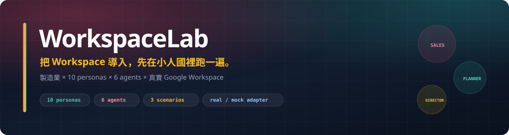
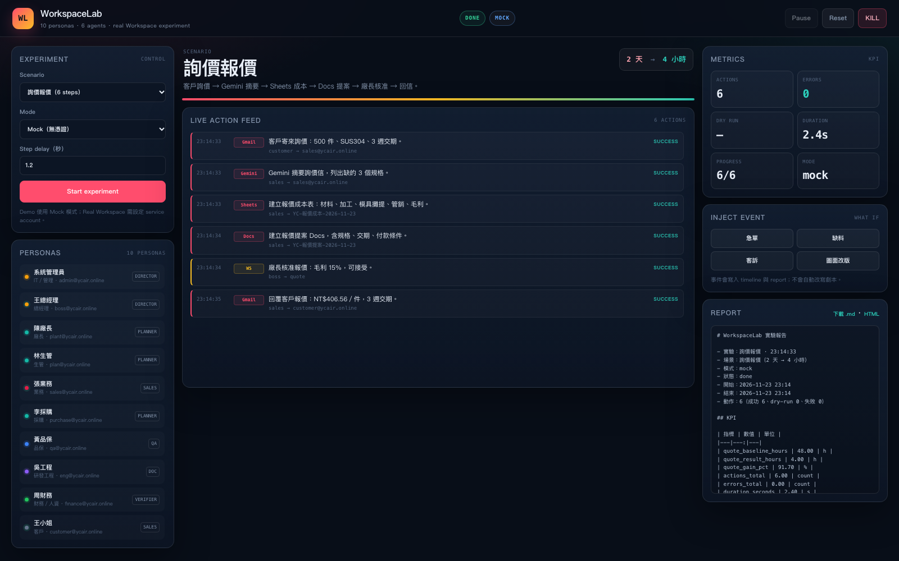
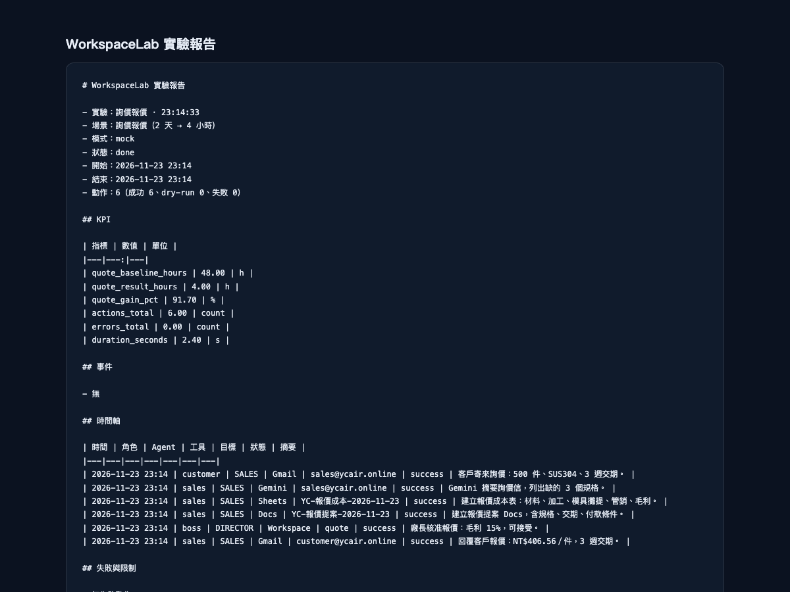

<div align="center">



**把 Workspace 導入，先在小人國裡跑一遍。**  
<em>A manufacturing-first Google Workspace adoption lab.</em>

[](https://github.com/ycair/workspace-lab/stargazers)
[](https://github.com/ycair/workspace-lab/network)
[](https://www.python.org/)
[]()

[繁體中文](./README.md)

</div>

## ⚡ 專案概述

**WorkspaceLab** 是一個面向製造業的 Google Workspace 導入實驗室。

它把一家 30 人金屬加工廠的日常，拆成 10 個角色與 6 個 AI agent：客戶、業務、生管、品保、廠長、採購、研發、財務、IT、外部顧問。這些角色會在一個可重跑的劇本裡，用真實的 Gmail、Drive、Docs、Sheets、Calendar、Forms 完成詢價、排程、品質三個場景。

> 你只需要：描述導入情境、選擇場景、按下開始  
> WorkspaceLab 會回傳：一條可追蹤的 action timeline、一組前後 KPI、一份可下載的實驗報告

### 我們的願景

Workspace 導入最難的，從來不是「開帳號」。

是人有沒有真的用、流程有沒有接起來、AI 有沒有真的省到時間。WorkspaceLab 讓企業在正式寄出第一封信、開第一場會議之前，先看一次「導入後的一天」：

- **零風險預演**：先用 Mock 模式跑完整劇本，不碰真實客戶。
- **可量化**：每個角色、每個動作、每個 KPI 都有紀錄。
- **可交接**：實驗報告可以直接變成導入建議、教育訓練與 PoC 範圍。

## 🚀 5 分鐘 Demo

目前提供**本機 Demo**；雲端版與 Demo 影片準備中。

```bash
git clone https://github.com/ycair/workspace-lab.git
cd workspace-lab
python3 -m venv .venv
.venv/bin/pip install -r requirements.txt
.venv/bin/python app.py
```

打開 http://127.0.0.1:8787：

1. Scenario 選「詢價報價」
2. Mode 選「Mock」
3. 按 **Start experiment**
4. 看 live feed、KPI、report
5. 下載 `.md` 或 `HTML` 報告

> Mock 模式不需要任何 Google 憑證，適合先看流程與報告。

## 📸 系統截圖

<div align="center">
<table>
<tr>
<td></td>
<td></td>
</tr>
<tr>
<td align="center"><sub>實驗控制台：10 個 persona、6 個 agent、live action feed</sub></td>
<td align="center"><sub>實驗報告：timeline、KPI、事件、失敗與建議</sub></td>
</tr>
</table>
</div>

## 🔄 工作流程

1. **種子**：公司訪談、流程圖、SOP、工單、報價單、Email、過去診斷報告。
2. **角色與圖譜**：抽出人、部門、流程、系統、痛點之間的關係，建立 10 個 persona。
3. **模擬**：6 個 agent 依劇本執行；可注入急單、缺料、客訴、圖面改版。
4. **真實 Workspace**：透過 adapter 呼叫 Gmail／Drive／Docs／Sheets／Calendar／Forms；預設 Dry-run 與 allowlist。
5. **報告**：產出 timeline、KPI、失敗、限制與下一步建議。

## ✨ 核心能力

| 能力 | 說明 |
|---|---|
| **10 個 persona** | 客戶、業務、生管、品保、廠長、採購、研發、財務、IT、外部顧問 |
| **6 個 agent** | Director、Sales、Planner、QA、Doc、Verifier |
| **3 個核心場景** | 詢價報價、排程急單、品質客訴 |
| **雙模式** | Mock（無憑證）／ Real Workspace（service account + delegation） |
| **真實 API adapter** | Gmail、Drive、Docs、Sheets、Calendar、Forms |
| **安全護欄** | 預設 Dry-run、收件人 allowlist、Kill switch、完整 audit log |
| **即時控制台** | Run／Pause／Resume／Reset／KILL、事件注入、live feed、KPI |
| **實驗報告** | Markdown／HTML，含 timeline、KPI、事件、失敗與建議 |

## 🏭 製造業場景

### 已實作：3 個核心場景

| 場景 | 痛點 | Workspace 做法 | 示範 KPI |
|---|---|---|---|
| **詢價報價** | 報價靠經驗、回覆慢 | Gmail＋Gemini → Sheets 成本 → Docs 提案 → eSignature | 2 天 → 4 小時 |
| **排程急單** | Excel 手排、急單難插 | 工單 Sheet → Gemini 找風險 → Chat 決策 → Calendar／Meet | 6 小時 → 2 小時 |
| **品質客訴** | 紙本檢驗、8D 版本亂 | Forms 異常 → Docs 8D → Chat 通知 → Sheets 追蹤 | 1 天 → 2 小時 |

### Roadmap：7 個延伸場景

圖面知識庫、缺料庫存、模具保養、現場報工、報表整合、教育訓練、供應商協作。

## 🧩 系統架構

```text
┌──────────────────────────────────────────────────────────┐
│ Web Dashboard（vanilla JS / CSS）                        │
│ 控制台、persona roster、live feed、KPI、report           │
└───────────────────────┬──────────────────────────────────┘
                        │ HTTP JSON / polling
┌───────────────────────▼──────────────────────────────────┐
│ Python App（http.server + sqlite3）                      │
│                                                          │
│  Experiment Engine                                       │
│   ├─ 10 Personas / 6 Agents                              │
│   ├─ Scenario scripts                                    │
│   ├─ Event injector                                      │
│   ├─ Tick loop                                           │
│   └─ Metrics / Report                                    │
│                                                          │
│  Workspace Adapter                                       │
│   ├─ MockAdapter（預設，無憑證可跑）                     │
│   └─ GoogleAdapter（service account + delegation）       │
│        Gmail / Drive / Docs / Sheets / Calendar / Forms  │
└───────────────────────┬──────────────────────────────────┘
                        │ Google APIs
┌───────────────────────▼──────────────────────────────────┐
│ 真實 Google Workspace tenant（測試 OU）                  │
└──────────────────────────────────────────────────────────┘
```

## 🔐 連接真實 Workspace

> 先確認你有一個**測試 tenant／測試 OU**。Real 模式預設 `DRY_RUN=1`，不會真的寄信。

### 1. Google Cloud

建立 project，啟用：

- Gmail API
- Google Drive API
- Google Docs API
- Google Sheets API
- Google Calendar API
- Google Forms API

建立 **Service Account**，下載 JSON key。

### 2. Domain-wide delegation

在 Google Workspace Admin console → Security → API controls → Domain-wide delegation，加入 service account 的 Client ID，授權：

```
https://www.googleapis.com/auth/gmail.modify
https://www.googleapis.com/auth/drive
https://www.googleapis.com/auth/documents
https://www.googleapis.com/auth/spreadsheets
https://www.googleapis.com/auth/calendar
https://www.googleapis.com/auth/forms.body
```

### 3. `.env`

```bash
cp .env.example .env
```

```env
GOOGLE_SERVICE_ACCOUNT_JSON=/absolute/path/to/service-account.json
GOOGLE_ADMIN_EMAIL=admin@your-domain.com
DRY_RUN=1
ALLOWLIST=@your-domain.com
```

### 4. 驗證

```bash
.venv/bin/python scripts/check_real.py
```

看到 `RESULT: real adapter can authenticate.` 才代表設定正確。

### 5. 先 Dry-run

UI 選 **Real Workspace**，Start。所有動作會顯示 `dry_run`，不會真的送出。

### 6. 第一次真實動作

只寄給 allowlist 內的測試信箱，確認 audit log 後再擴大。

## 🛡️ 安全與實驗倫理

- 預設 `DRY_RUN=1`；要真的執行必須明確關閉。
- 非 allowlist 收件人直接拒絕。
- `KILL` 停止所有新動作。
- 一次只跑一個 experiment。
- 每個 action 寫入 SQLite audit log。
- 只在測試 OU／測試使用者／測試信箱執行。
- 不要把 service account JSON、`.env`、`data/` 進 git。
- 不要把真實客戶圖面放進外部共享資料夾。

## 📊 實驗報告

每次實驗會產生：

- 實驗基本資料：場景、模式、狀態、開始／結束
- KPI：baseline、結果、改善幅度、actions、errors、duration
- 事件：急單、缺料、客訴、圖面改版
- 時間軸：每個角色、工具、目標、狀態、摘要
- 失敗與限制
- 下一步建議

## ⚠️ 目前限制

| 項目 | 狀態 |
|---|---|
| Chat 以使用者身分發訊息 | 未支援（Google Chat API 主要支援 Chat app） |
| Meet 錄影／逐字稿／Gemini 筆記 | 未支援（需 UI／權限） |
| Gemini in Gmail／Docs 的完整 UI | 未支援（目前用模板／log 表示 AI 步驟） |
| AppSheet App 建立 | 未支援（無公開建立 API） |
| 多租戶／計費／正式產品化 | 未支援 |

> 這些不是忽略，是第二階段用 Playwright／Chat app／Meet API 補。

## 🗺️ Roadmap

| 階段 | 內容 |
|---|---|
| **MVP（現在）** | 10 personas、6 agents、3 場景、Mock + Real adapter、報告 |
| **Next** | Chat／Meet／Gemini UI 的瀏覽器 adapter、AppSheet、更多場景 |
| **Later** | 多租戶、權限管理、雲端部署、LLM 自動產生劇本 |

## 📁 專案結構

```text
workspace-lab/
├── app.py                 # HTTP server + API
├── engine/
│   ├── models.py
│   ├── store.py           # SQLite
│   ├── personas.py        # 10 personas / 6 agents
│   ├── scenarios.py       # 3 scenarios
│   ├── simulator.py       # run / pause / event
│   ├── workspace.py       # Mock + Google adapter
│   └── report.py
├── web/                   # dashboard
├── tests/
├── scripts/check_real.py
├── docs/
│   ├── design.md
│   └── assets/
├── data/                  # SQLite + logs（不進 git）
└── exports/               # screenshots / reports
```

## 🤝 聯絡與合作

- 有問題或想合作：請開 [GitHub Issue](https://github.com/ycair/workspace-lab/issues)
- 東海大學智慧轉型中心：Workspace 導入、AI 診斷、製造業輔導

## 📄 授權

本專案為展示與實驗用途。若要商業使用、客製導入或教學授權，請與東海大學智慧轉型中心聯絡。

## 🙏 致謝

- 架構靈感來自 **[MiroFish](https://github.com/666ghj/MiroFish)** 的「種子 → 圖譜 → persona → 模擬 → 報告」流程；程式為獨立實作，未複製其程式碼。
- 感謝 Google Workspace APIs 與開源社群。

---

<div align="center">
<sub>WorkspaceLab · 東海大學智慧轉型中心 · 2026</sub>
</div>
